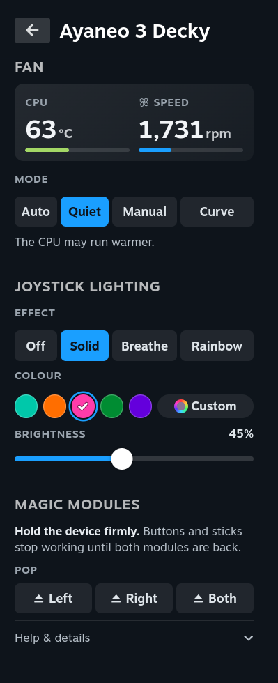
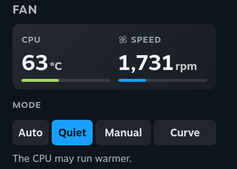
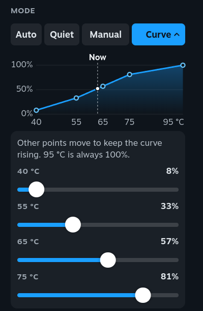
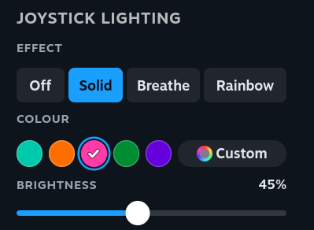
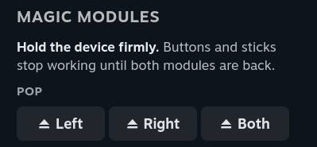

# Ayaneo 3 Decky

Fan control, joystick lights and Magic Modules for the AYANEO 3, right in the Steam quick menu.

## Install

1. You need [Decky Loader](https://decky.xyz). On Bazzite: switch to Desktop Mode, open a terminal and type `ujust setup-decky`.
2. Download the plugin with the button above. Don't unzip it.
3. In Gaming Mode, open the Decky menu, press the gear, and turn on **Developer mode**.
4. Go to **Developer**, choose **Install Plugin from ZIP File**, and pick the file you downloaded.
5. Open **Ayaneo 3 Decky** from the Decky menu.

## What it does

**Fan.** See how warm the CPU is and how fast the fan spins. Pick a mode:
**Auto** (the device decides), **Quiet**, **Manual** (one fixed speed) or **Curve** (your own).
Press **Curve** again to change its points.

 

**Joystick lights.** Turn the rings off, or pick an effect, a colour and how bright they are.
Press **Custom** to mix your own colour.

**Magic Modules.** Press **Left**, **Right** or **Both** to release a module. Hold the device while you do.
Put the modules back on their own sides and the controls come back on their own.

Your choices are remembered, and the fan goes back to Auto whenever Decky stops.

---

Works on the AYANEO 3 with Bazzite. [More help](docs/INSTALL.md) · [How it works](docs/TECHNICAL.md) · [Changes](CHANGELOG.md) · Licence: [GPL-3.0-or-later](LICENSE)
